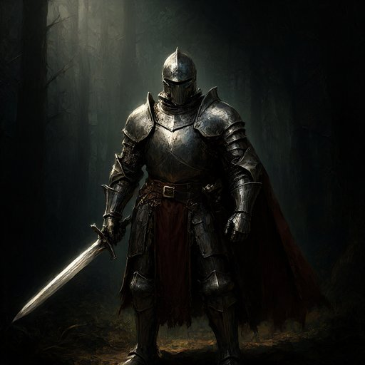

# Anima

An Android app that draws pictures and short clips, and chats, entirely on the phone. The models run on the phone's
neural unit (Qualcomm QNN / HTP) or its graphics chip; the internet is only used to download models and app updates.

It works best on phones with the **Snapdragon 8 Elite** (HTP v79) or the **Snapdragon 8 Elite Gen 5** (HTP v81),
where every model can run on the neural unit. Other phones work too, more slowly:

- **Snapdragon 8 Gen 3 and 8 Gen 2:** Anima runs on the neural unit; the other picture models run on the graphics
  chip.
- **Any other phone with Android 9 or newer (64-bit Arm):** the picture models run on the graphics chip. It has been
  tried on a Sony Xperia XZ3 (Snapdragon 845).
- On all of these, the chat uses the smaller Qwen3.5 0.8B on the phone's processor.

The larger models need a lot of memory and are much slower on older phones.

## What it can do

| Model | What it does | Time* |
|---|---|---|
| **Anima Turbo** | Anime pictures in six sizes, with an optional guide picture and a 4× upscaler | about 6–17 s |
| **FLUX.2 [klein] 4B** | Pictures from plain sentences, and picture editing | about 8 s; edits about 20 s |
| **Krea 2 Turbo** (8 steps) | 768×768 pictures from text | not timed on these phones yet |
| **Qwen-Image 2.1 Turbo** (8 steps) | 768×768 pictures, and picture editing | about 2½ min; edits about 5 min |
| **Fibo 2.0** | Picture editing only | about 75 s |
| **MOSS-Image** (8-step version) | Pictures | about 1¾ min |
| **Wan 2.2 5B** | Turns a picture into a short moving clip (768×768, 96 frames), saved as MP4 | about 2½ min |

\* Measured on an iQOO 13 and a Samsung S25 Edge, both Snapdragon 8 Elite, on the neural unit.

- **Queue.** Pictures wait in a queue that keeps drawing in the background, with a progress notification and a
  "Picture ready" notification for each one.
- **Chat.** The Chat tab talks to [Ling-3.0-tiny](https://huggingface.co/inclusionAI/Ling-3.0-tiny) (or the
  smaller Qwen3.5 0.8B) on the same phone, through llama.cpp's Hexagon backend. Phones without an 8 Elite chip chat
  with Qwen3.5 0.8B on the processor. Ask it for a picture and it picks
  Anima or Qwen-Image, writes the prompt, adds it to the queue, and shows the picture in the conversation.
- **Updates.** The app updates itself from this repo's releases.

## Samples

Made on Snapdragon 8 Elite Gen 5 phones, with the prompts below, and shown here smaller.

| | | |
|---|---|---|
|  |  |  |
| **Anima Turbo:** masterpiece, best quality, safe, 1girl, solo, silver hair, long hair, blue eyes, smile, school uniform, cherry blossoms, falling petals, outdoors, spring, soft light | **FLUX.2 klein:** a cozy coffee shop interior with plants, warm light, people chatting, film photography | **Krea 2 Turbo:** a red fox sitting in fresh snow, morning light, photo |
|  |  |  |
| **Qwen-Image 2.1:** A digital painting of a knight in silver armor holding a glowing sword in a dark forest, dramatic lighting. | **MOSS-Image:** A lighthouse on a rocky cliff at sunset, waves crashing below, warm golden light. | **Fibo 2.0**, editing the Krea fox: Make it night with a starry sky and green northern lights |
|  | | |
| **Wan 2.2**, a 3-second moving picture made from the Anima picture above: She smiles and turns her head slowly toward the camera, her hair and the petals moving in a light breeze. | | |

## Downloads

On first launch a setup screen lists the models this phone can run, with their download sizes. Tick the ones you
want and they download side by side; Settings opens the same screen later.

The compiled neural-unit files only run on the chip they were built for, so the app picks the right repo for the
phone. Every picture model also has a graphics-chip build, offered next to the neural-unit one on the Models screen
("Draws on"). A build that isn't available for a phone is shown greyed out, not hidden.

| Model | Snapdragon 8 Elite | Snapdragon 8 Elite Gen 5 | Graphics chip |
|---|---|---|---|
| Anima Turbo | [anima-qnn-8elite](https://huggingface.co/sebekblessing/anima-qnn-8elite) | [anima-qnn-8elite-gen5](https://huggingface.co/sebekblessing/anima-qnn-8elite-gen5) | [anima-gpu](https://huggingface.co/sebekblessing/anima-gpu) |
| FLUX.2 [klein] 4B | [klein-4b-qnn-8elite](https://huggingface.co/sebekblessing/klein-4b-qnn-8elite) | [klein-4b-qnn-8elite-gen5](https://huggingface.co/sebekblessing/klein-4b-qnn-8elite-gen5) (768×768, square only) | [klein-4b-gpu](https://huggingface.co/sebekblessing/klein-4b-gpu) |
| Krea 2 Turbo | [krea-2-turbo-qnn-8elite](https://huggingface.co/sebekblessing/krea-2-turbo-qnn-8elite) (not yet tried on a phone) | [krea-2-turbo-qnn-8elite-gen5](https://huggingface.co/sebekblessing/krea-2-turbo-qnn-8elite-gen5) | [krea-2-turbo-gpu](https://huggingface.co/sebekblessing/krea-2-turbo-gpu) |
| Qwen-Image 2.1 | [qwen-image-2.1-qnn-8elite](https://huggingface.co/sebekblessing/qwen-image-2.1-qnn-8elite) | [qwen-image-2.1-qnn-8elite-gen5](https://huggingface.co/sebekblessing/qwen-image-2.1-qnn-8elite-gen5) | [qwen-image-2.1-gpu](https://huggingface.co/sebekblessing/qwen-image-2.1-gpu) (pictures only, no edits) |
| Fibo 2.0 | [fibo-qnn-8elite](https://huggingface.co/sebekblessing/fibo-qnn-8elite) | [fibo-qnn-8elite-gen5](https://huggingface.co/sebekblessing/fibo-qnn-8elite-gen5) | [fibo-gpu](https://huggingface.co/sebekblessing/fibo-gpu) |
| MOSS-Image | [moss-qnn-8elite](https://huggingface.co/sebekblessing/moss-qnn-8elite) | [moss-qnn-8elite-gen5](https://huggingface.co/sebekblessing/moss-qnn-8elite-gen5) | [moss-gpu](https://huggingface.co/sebekblessing/moss-gpu) |
| Wan 2.2 5B | [wan22-qnn-8elite](https://huggingface.co/sebekblessing/wan22-qnn-8elite) | [wan22-qnn-8elite-gen5](https://huggingface.co/sebekblessing/wan22-qnn-8elite-gen5) | [wan22-gpu](https://huggingface.co/sebekblessing/wan22-gpu) |

The chat models are plain llama.cpp files that run on both chips:
[anima-chat-models](https://huggingface.co/sebekblessing/anima-chat-models).

To build any of these files yourself from the original models, each model repo has the scripts and a step-by-step
guide in its `build/` folder.

## Licences

- Anima, Qwen-Image and Fibo: **non-commercial use only**.
- FLUX.2 [klein] 4B, MOSS-Image and Wan 2.2: Apache 2.0 (the Wan Turbo version's page names no licence).
- Krea 2 Turbo: the Krea 2 Community License, by Krea.
- Ling-3.0-tiny: MIT, by inclusionAI.

Each model repo has its licence and notice files.

## Disclaimer

All of the code in this repository was written by an AI coding assistant (Claude, by Anthropic). It is shared
as-is, without any warranty, and you use it at your own risk. I am not responsible for any problem it causes,
including crashes, lost data, wrong results, or a phone that runs hot or is damaged. The model files have their
own licences; see their Hugging Face pages.

## Building the app

You need the Android SDK, NDK r28 and Qualcomm QAIRT 2.50.40 (for the QNN headers). Put
`qnn.sdk.dir=<QAIRT folder>` in `local.properties`, or set `QNN_SDK_ROOT`. Then:

    ./gradlew assembleDebug

The QNN runtime libraries for the phone are already in `app/src/main/jniLibs/arm64-v8a` (from QAIRT 2.50.40).

**Chat.** The chat runs llama.cpp's server as a separate program inside the app. Build llama.cpp for Android with
`-DGGML_HEXAGON=ON` (Hexagon SDK 6.6), then copy it in, stripped:

    LLAMA_BUILD=<llama.cpp build folder> tools/pack-llama.sh

**Publishing an update.** This builds with a time stamp as the build number and publishes `anima.apk` and
`latest.json` as a new release of this repo, where installed copies look for updates. It needs the GitHub CLI,
logged in:

    tools/publish-app.sh "what changed"

## Where things are

- `app/src/main/cpp/` — the neural-unit engine on the QNN C API: `qnn_runner` (loads and runs one compiled piece),
  `pipeline` (Anima), `klein` (FLUX.2 klein), `qimg` (Qwen-Image), `fibo`, `moss`, `wan`, `gemma` (shared context
  code) and `jni_bridge`.
- `app/src/main/java/com/anima/npu/` — the Compose screens, tokenizers (ComfyUI's rules), downloads, gallery, usage
  bar and self-test. Also:
  - the queue: `QueueStore`, `QueueService`, `Drawer`
  - the chat: `LocalLing` starts the server, `ChatController` runs a turn and the `draw_picture` tool, `ChatScreen`
  - `NpuGate`, which makes the queue and the chat take turns on the neural unit
  - `AppUpdate`, the self-update
- `tools/*_cli.cpp` — command-line test programs that run a model on a phone over adb (built by
  `tools/build_cli.sh`).
